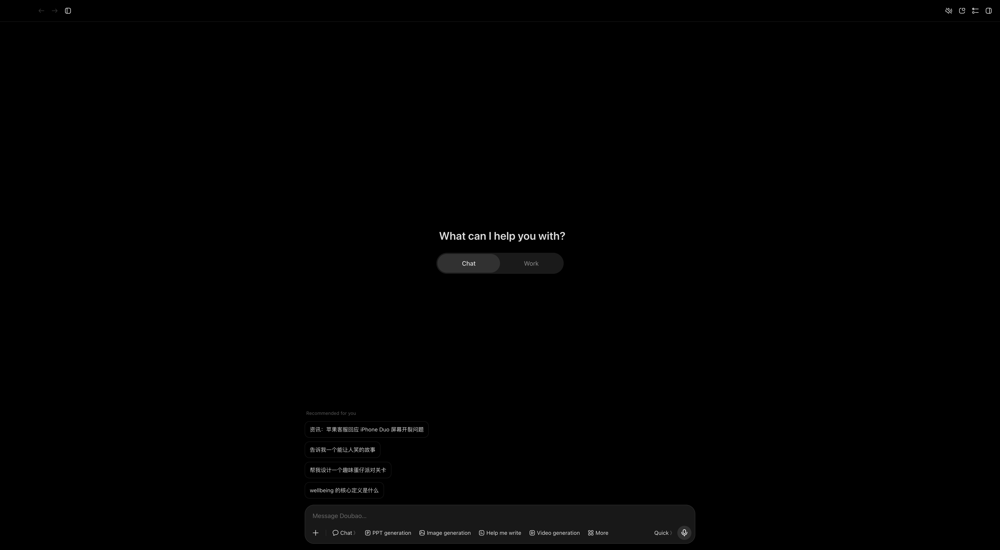

# Doubao EN — English UI for the Doubao macOS desktop app

[](https://github.com/hongkongkiwi/doubao-osx-english/releases)
[](LICENSE)

The Doubao (豆包) desktop app for macOS is Chinese-only: it has no in-app
language setting, actively deletes the macOS per-app language override, and
ignores Electron's `--lang` flag. Doubao EN adds an English interface
**without modifying the app itself**, so it keeps working across Doubao
updates.



## How it works

Doubao's UI is web content running in an embedded Chromium browser, with all
strings delivered from ByteDance's servers at launch. Doubao EN:

1. relaunches Doubao with a localhost DevTools port (`127.0.0.1:9223`);
2. injects a translator into every page and frame — main window, sub-pages,
   dialogs and popovers (a fast 250 ms overlay pass plus a 3-second full
   sweep, so new surfaces never sit in Chinese for long);
3. translates with a **540-entry curated dictionary** of exact UI labels,
   plus **regex rules auto-generated from placeholder templates** — so
   interpolated strings like `5 分钟前` → "5 minutes ago" and
   `report.pdf 上传失败` → "report.pdf upload failed" translate correctly;
4. keeps an `setAttribute` intercept so framework re-renders that restore a
   Chinese label (the composer placeholder, for example) land as English.

Because nothing inside `Doubao.app` is modified — no re-signing, no patched
resources — **the auto-updater works normally and the translation survives
every upgrade**. When ByteDance ships new strings, coverage grows through the
collector + dictionary loop below.

**Deliberately not translated:** your chat titles, AI answers, and the
rotating suggestion chips on the home screen (server-generated content —
recurring shapes like `News: …` are pattern-translated; brand-new prompts
arrive in Chinese). The macOS menu bar is native and out of reach.

## Requirements

- macOS 12+
- [Doubao for Mac](https://www.doubao.com/download) installed
- Node.js 22+ (`brew install node` — the built-in `WebSocket` is required)

## Install

**From a release (easiest):** grab
[`Doubao EN.app`](https://github.com/hongkongkiwi/doubao-osx-english/releases/latest)
from Releases, move it to `/Applications`, launch it.

**From source:**

```bash
git clone https://github.com/hongkongkiwi/doubao-osx-english.git
cd doubao-osx-english
./install.sh          # builds + installs /Applications/Doubao EN.app
```

`install.sh` verifies Doubao and Node, builds a **self-contained** wrapper
app (the translator code is embedded — it keeps working even if you move or
delete this repo) and ad-hoc signs it.

## Run

Launch **Doubao EN** instead of Doubao — Spotlight (⌘Space → "doubao en"),
Launchpad, or `/Applications`. Then:

- Doubao quits and relaunches with the DevTools port; English applies a few
  seconds after the window appears.
- New windows, settings pages and dialogs translate within ~1–3 seconds.
- Quitting Doubao quits Doubao EN; plain Doubao.app still launches
  untranslated if you start it directly.
- Logs land in `~/Library/Logs/doubao-en.log` when run from the app.

## Upgrading Doubao

Do nothing. Doubao's auto-updater works normally; Doubao EN relaunches it
with the translator on every start. If an update renames a string, that one
label stays Chinese until the dictionary learns it (next section).

## Add missing translations

**Quick, local-only:** create
`~/Library/Application Support/DoubaoEN/user-dictionary.json`:

```json
{ "收藏夹": "Saved", "检查更新": "Check for updates" }
```

It merges over the built-in dictionary on every launch — restart Doubao EN
to apply. No reinstall needed.

**Permanent (helps everyone):**

```bash
node bin/doubao-en.js --collect     # while the screen you want is open
# → writes visible untranslated strings to doubao-en-strings.txt
#   (your chat titles appear too — don't add those)
```

Translate what you need, add entries to `lib/dictionary.js`, run
`./install.sh`. Pull requests welcome.

**Bulk translation (long tail):** the app's full string universe (~25k
strings, extracted from its loaded scripts) is in
`extracted-strings.txt` / `data/untranslated-ui-strings.txt`. To translate
the remainder by machine, point `scripts/translate-strings.js` at any
OpenAI-compatible endpoint:

```bash
MT_URL=https://api.example.com/v1/chat/completions \
MT_KEY=sk-… MT_MODEL=gpt-4o-mini \
node scripts/translate-strings.js data/untranslated-ui-strings.txt lib/dictionary-mt.json
node scripts/merge-mt.js             # merge + dedupe against curated entries
./install.sh
```

`lib/dictionary-mt.json` (machine translations) sits below curated entries in
precedence, so a bad translation can always be overridden in
`lib/dictionary.js`.

## CLI reference

| Command | What it does |
| --- | --- |
| `node bin/doubao-en.js` | inject + keep watching for new windows |
| `node bin/doubao-en.js --once` | inject into current windows and exit |
| `node bin/doubao-en.js --collect` | dump untranslated visible strings |
| `node bin/doubao-en.js --screenshot out.png` | capture the Doubao window |
| `node bin/doubao-en.js --no-launch` | never start/quit Doubao; attach only |
| `node scripts/extract-strings.js` | pull **every** Chinese string literal from all loaded scripts (25k+) |
| `node scripts/translate-strings.js in.txt out.json` | bulk-translate via any OpenAI-compatible endpoint |
| `node scripts/merge-mt.js` | merge `mt-work/out-*.json` results into the dictionary |

Environment: `DOUBAO_EN_PORT` (default 9223), `DOUBAO_APP` (default
`/Applications/Doubao.app`), `DOUBAO_EN_USER_DICT` (user dictionary path).

## Repo layout

```
bin/doubao-en.js        launcher + injector (DevTools attach, watch loop)
lib/translator.js       in-page translator (sweep, rules, setAttribute shim)
lib/dictionary.js       curated zh→en dictionary (540 entries)
lib/dictionary-mt.json  machine-translated long tail (optional, generated)
scripts/make-app.sh     builds the self-contained "Doubao EN.app" wrapper
scripts/extract-strings.js   full string-universe extractor (DevTools)
scripts/translate-strings.js bulk MT via any chat-completions endpoint
scripts/merge-mt.js     merge MT results into the dictionary
data/untranslated-ui-strings.txt   extracted strings not yet translated
```

## Troubleshooting

| Symptom | Fix |
| --- | --- |
| Opens but stays Chinese | Node 22+ missing (`node --version`); check `~/Library/Logs/doubao-en.log` |
| "DevTools port never came up" | A Doubao instance was mid-quit — wait a few seconds, relaunch Doubao EN |
| Port 9223 already in use | `DOUBAO_EN_PORT=9300 open -a "Doubao EN"` |
| Some labels Chinese after an update | `--collect` → extend dictionary (or user-dictionary.json) |
| Gatekeeper blocks the download | `xattr -cr "/Applications/Doubao EN.app"` |

## Security notes

While Doubao EN runs, Doubao listens on `127.0.0.1:9223` (Chromium DevTools,
localhost-only). Any process running as your user could attach to the app
while that port is open. If that matters for your threat model, launch plain
Doubao when you don't need the translation.

## Releases

Tags build automatically: `git tag v1.0.9 && git push origin v1.0.9`
publishes a zip with the self-contained wrapper via GitHub Actions.

## Uninstall

```bash
./uninstall.sh        # or just delete /Applications/Doubao EN.app
```

Doubao itself is untouched — no settings, files or preferences are changed.

## Disclaimer

Unofficial, community-made. Not affiliated with or endorsed by ByteDance.
It intercepts no network traffic — it rewrites local UI text only — but you
use it at your own risk.
